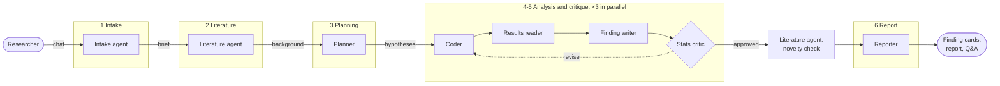
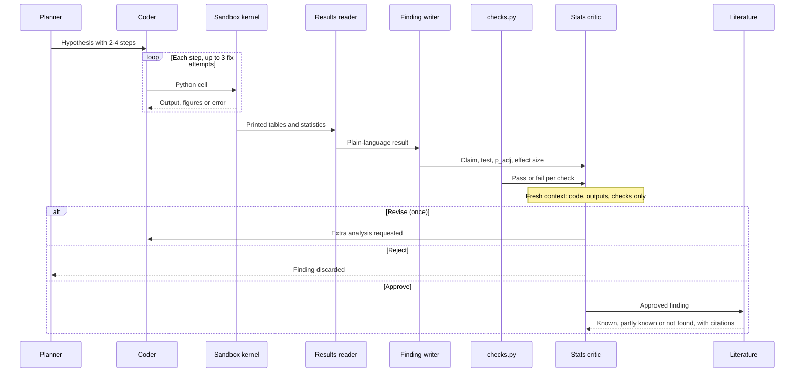
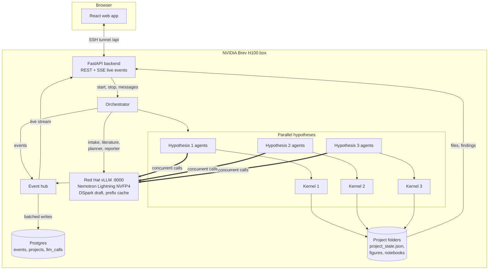
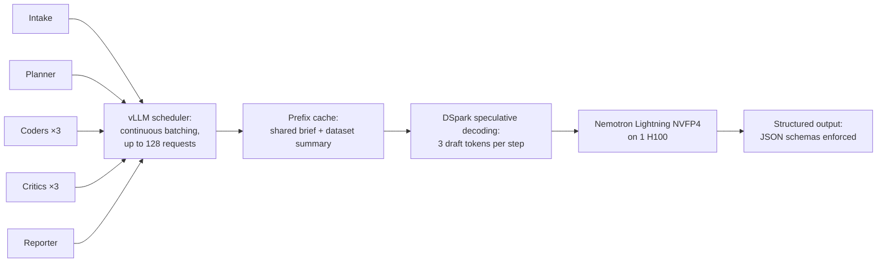

# SCRAP: Single-cell RNA-seq Analysis Pipeline

**A team of AI agents that re-analyses public single-cell data, running on one small open model on a single GPU.**

**Track:** Multi-Agent Systems · **Bounties:** Best Use of NVIDIA Nemotron Lightning, Best Use of Red Hat vLLM
**Stack:** NVIDIA Nemotron 3.5 Lightning (31.6B total, 3.6B active) · Red Hat vLLM · NVIDIA Brev H100 · open data from GEO and CZ CELLxGENE

[Screenshot: COVID-19 project page with finding cards (volcano and bar charts)]

## The problem

Most public biological data is analysed once, for one paper. A study of NCBI GEO found that only about 20% of gene expression datasets deposited between 2003 and 2007 had been reused by another team, so roughly four in five were never reanalysed (Piwowar & Vision, 2013).

A careful reanalysis takes a bioinformatician days. Agent systems that automate it, such as CellVoyager, depend on large closed frontier models: you pay per token, send potentially sensitive data to a third party, and can't host the system yourself. SCRAP runs **every agent on one small open model that you host**: cheap enough for many agents at once, private, and reproducible on one rented GPU.

## How it works

SCRAP is a team of eight specialised agents, each a separate role played by the same model with its own prompt, inputs and output format. An orchestrator moves a project through fixed stages and passes each agent only what it needs.



**1. Intake.** Preprocessing builds a dataset summary: cell counts, metadata columns, condition labels and gene ID format. The intake agent reads it, asks you only what it can't infer, and fills in a structured brief (organism, condition and donor columns, cell types, goals).

**2. Literature.** The literature agent searches Europe PMC and any papers you upload, and writes a cited background of what is already known.

**3. Planning.** The planner proposes two to three hypotheses that build on the background rather than repeat it, each with two to four concrete steps.

**4. Analysis, in parallel.** Each hypothesis gets its own coder, sandboxed Jupyter kernel and critic, and all of them run at once. The coder writes Python that prints the numbers behind every plot, retrying up to three times on errors. The results reader turns the output into plain language, and the finding writer drafts the claim with its statistic, adjusted p-value and effect size.

**5. Critique.** The stats critic starts from a fresh context, seeing only the code, outputs and a report from `checks.py`: pseudobulking by donor, multiple-testing correction, effect size, confounding and cell counts. It approves, rejects, or requests one more analysis; an unresolved request counts as a rejection, and failed hard checks override its approval. Approved findings go back to the literature agent, which labels them known, partly known or not found, with citations.

**6. Report.** The reporter writes finding cards and a final report, then answers your follow-up questions in the chat.



This division of labour is what one model can't do alone: no single prompt holds the data context, the statistics rules and an adversarial review at once, and hypotheses are explored in parallel.

[Screenshot: intake chat with the files panel showing a notebook preview]



[Screenshot: a finding card with chart, p_adj, effect size and "Critic approved"]

## Why NVIDIA Nemotron Lightning

Running eight agent roles across parallel hypotheses means many model calls at once, so the model must be cheap and fast without being weak. **Nemotron Lightning** is a mixture-of-experts model with 31.6B parameters, of which only 3.6B are active for each token. It brings the knowledge of a large model to every call at roughly the compute cost of a small one, which is what lets three hypotheses run side by side on one GPU.

Reasoning is switched on per request. The planner, coder and critic think before answering, where careful reasoning pays off; the reporter answers directly, where speed matters. The model's reasoning is returned separately from its answer, so the app's trace shows each agent's working notes. Lightning's tool calling and its long context also let agents work with full dataset summaries and earlier cells.

Because the model is open, the whole system runs where the data is. No dataset or patient metadata ever leaves the box.

## Why Red Hat vLLM

**Red Hat vLLM** turns one H100 into a server for the whole agent team; each feature maps onto how SCRAP works:



- **Continuous batching** serves concurrent agents together instead of queueing them. Ten calls took 6.9 seconds in parallel versus 55.7 seconds one after another.
- **Prefix caching** reuses the brief and dataset summary that begins every agent's prompt, instead of recomputing it for each call.
- **DSpark speculative decoding** has a small draft model propose three tokens that Lightning verifies in one pass; about two-thirds are accepted, so generation runs faster.
- **Structured output** makes vLLM constrain answers to JSON schemas: the planner can't return a hypothesis with fewer than two steps, and the critic's verdict always parses.
- **Reasoning and tool-call parsers** split thinking from answers for the trace.
- **NVFP4 weights** keep the model compact, leaving GPU memory for many requests at once.

**NVIDIA Brev** makes the stack reproducible: one script rebuilds the box from scratch.

## Open data

SCRAP analyses the COVID-19 PBMC atlas of Wilk et al. (2020), GEO [GSE150728](https://www.ncbi.nlm.nih.gov/geo/query/acc.cgi?acc=GSE150728), using the annotated `.h5ad` from [CZ CELLxGENE](https://cellxgene.cziscience.com/collections/a72afd53-ab92-4511-88da-252fb0e26b9a) (44,649 cells after QC), plus literature from Europe PMC.

## Rules compliance

Nemotron Lightning has 31.6B total parameters, under the 33B limit. All code was written during the event; every library is at least two weeks old (`exclude-newer` in `pyproject.toml`).

## Getting started

```bash
cp .env.example .env && docker compose up -d db               # Postgres
bash infra/serve_vllm.sh                                      # vLLM + Nemotron Lightning
uv run uvicorn backend.main:app --host 127.0.0.1 --port 8080  # backend
cd frontend && npm install && VITE_USE_MOCK=false npm run dev # web app
```

Without a GPU, `SCRAP_AGENTS=replay` plays back a recorded run.

## Future work

More CELLxGENE datasets and your own uploads, steering a run from the chat, fine-tuning the critic with NVIDIA NeMo Gym, and live vLLM metrics in the app.

## Team

Alexandre Tourneux (agents, sandbox, serving, benchmarks) and John (backend, database, web app).

## References

- Wilk, A.J. et al. A single-cell atlas of the peripheral immune response in patients with severe COVID-19. *Nat Med* 26, 1070–1076 (2020).
- Piwowar, H.A. & Vision, T.J. Data reuse and the open data citation advantage. *PeerJ* 1:e175 (2013).
